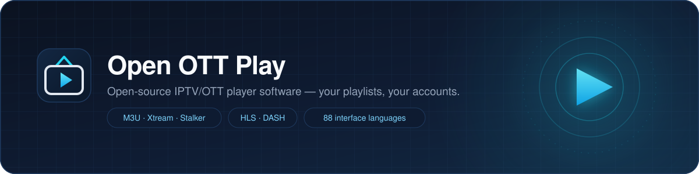
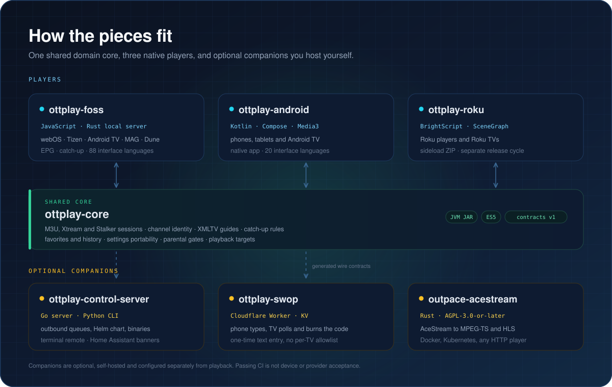
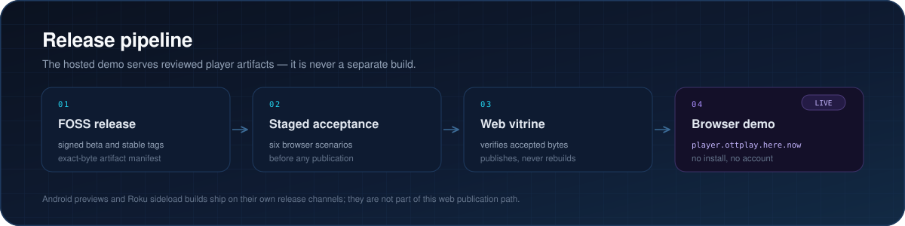

  

  
  
  
  
  

**Open OTT Play** builds open-source IPTV/OTT software for smart TVs, set-top boxes, phones and browsers. Every player runs on the playlist or provider account you already have: there is no subscription, no built-in catalogue, and no permission to access a source implied by the software. Companion services are optional, self-hosted, and configured separately from playback.

## Start here

| I want to… | Go to |
| --- | --- |
| Try the full player in a browser, no install | **[player.ottplay.here.now](https://player.ottplay.here.now/)** |
| Install on a TV, set-top box or desktop | **[ottplay-foss](https://github.com/open-ott-play/ottplay-foss)** · [wiki](https://github.com/open-ott-play/ottplay-foss/wiki) · [releases](https://github.com/open-ott-play/ottplay-foss/releases) |
| Use a native Android and Android TV app | **[ottplay-android](https://github.com/open-ott-play/ottplay-android)** · [signed preview](https://github.com/open-ott-play/ottplay-android/releases) |
| Run it on Roku | **[ottplay-roku](https://github.com/open-ott-play/ottplay-roku)** · [downloads](https://roku.ottplay.here.now/) |
| Drive players from a terminal or Home Assistant | **[ottplay-control-server](https://github.com/open-ott-play/ottplay-control-server)** |
| Type on the TV from a phone | **[ottplay-swop](https://github.com/open-ott-play/ottplay-swop)** |
| Add AceStream sources | **[outpace-acestream](https://github.com/open-ott-play/outpace-acestream)** |
| Read the shared domain rules or build a new client | **[ottplay-core](https://github.com/open-ott-play/ottplay-core)** |

## Players

### [ottplay-foss](https://github.com/open-ott-play/ottplay-foss) · browsers, smart TVs and set-top boxes

Self-contained player with a local Rust HTTP(S) server. It runs in desktop browsers, on LG webOS, Samsung Tizen, Panasonic and Sony TVs, Infomir MAG, Dune HD, Enigma2 and Android TV boxes, and through desktop and Capacitor wrappers. Sources are M3U playlists, Xtream accounts and Stalker portals, with XMLTV guides, catch-up, movies and series.

Start with the [architecture and contributor guide](https://github.com/open-ott-play/ottplay-foss/blob/main/docs/architecture.md), then the [documentation wiki](https://github.com/open-ott-play/ottplay-foss/wiki). Offline playback is covered in [local videos](https://github.com/open-ott-play/ottplay-foss/blob/main/docs/offline-media.md), and the quick starts exist for all 88 interface languages.

### [ottplay-android](https://github.com/open-ott-play/ottplay-android) · native Android and Android TV

Independent Kotlin and Jetpack Compose application with Media3 playback and its own app identity, so it can be installed next to the FOSS player. It requires Android 8.0 / API 26 or later, ships 20 interface languages offline, keeps source settings and EPG URLs encrypted with an Android Keystore key, and includes an offline demo clip.

Read [provider compatibility](https://github.com/open-ott-play/ottplay-android/blob/main/docs/PROVIDER-COMPATIBILITY.md), [local videos](https://github.com/open-ott-play/ottplay-android/blob/main/docs/LOCAL-VIDEOS.md), [DRM boundaries](https://github.com/open-ott-play/ottplay-android/blob/main/docs/DRM.md) and the [migration guide](https://github.com/open-ott-play/ottplay-android/blob/main/docs/MIGRATION.md).

### [ottplay-roku](https://github.com/open-ott-play/ottplay-roku) · Roku players and Roku TVs

Native BrightScript and SceneGraph client for user-supplied M3U playlists and local videos, delivered as a reproducible sideload ZIP on its own release cycle. [Downloads and installation](https://roku.ottplay.here.now/) · [installation guide](https://github.com/open-ott-play/ottplay-roku/blob/main/docs/installation.md) · [architecture](https://github.com/open-ott-play/ottplay-roku/blob/main/docs/architecture.md).

## Shared core

[**ottplay-core**](https://github.com/open-ott-play/ottplay-core) owns the business logic every client shares: M3U, Xtream and Stalker sessions, channel identity, XMLTV matching, catch-up rules, favourites and history, settings portability, parental gates and playback targets. It publishes JVM and ES5 distributions plus the [wire contracts](https://github.com/open-ott-play/ottplay-core/blob/main/contracts/README.md) consumed by the companion services, and it contains the independent [FOSS2 browser client](https://github.com/open-ott-play/ottplay-core/tree/main/ottplay-foss2).

Consumers carry qualified artifacts and build without a sibling core checkout or a Kotlin compiler. iOS runs the same JavaScript in JavaScriptCore; the Rust server runs it in QuickJS-NG, including Alpine and musl builds.

## Optional companions

| Companion | What it adds | Runs as |
| --- | --- | --- |
| [ottplay-control-server](https://github.com/open-ott-play/ottplay-control-server) | Remote commands delivered through outbound player requests, a terminal remote, resumable settings control and Home Assistant event banners | Go server and Python CLI, portable binaries, container image, Helm chart |
| [ottplay-swop](https://github.com/open-ott-play/ottplay-swop) | One-time phone-to-player text entry; the TV polls and burns the code after reading it | Cloudflare Worker with KV, authorised per installation |
| [outpace-acestream](https://github.com/open-ott-play/outpace-acestream) | Public, unencrypted AceStream sources converted to MPEG-TS and HLS for any HTTP-capable player | Rust binary, Docker, Kubernetes and k3s; independent fork of Outpace under AGPL-3.0-or-later |

The control server needs controller and CLI revisions that match its documented features; pairing and administrator access are configured separately from playback. See [reliable control](https://github.com/open-ott-play/ottplay-control-server/blob/main/docs/reliable-control.md) and [Home Assistant banners](https://github.com/open-ott-play/ottplay-control-server/blob/main/docs/home-assistant.md).

## How the pieces fit

Each player keeps its own platform layer: UI, focus handling, codecs and lifecycle. The shared core keeps the domain rules and wire contracts. Companions never proxy playback: the control server only carries outbound commands, SWOP only relays text, and the engine presents a local HTTP stream that any player can open.

## Documentation

The [player documentation wiki](https://github.com/open-ott-play/ottplay-foss/wiki) is the exported English documentation set, and every page names the source revision it was exported from. It is the fastest way to read the operational detail without cloning a repository.

| Wiki page | Covers |
| --- | --- |
| [Home](https://github.com/open-ott-play/ottplay-foss/wiki) | Start, install paths and the full page index |
| [Browser compatibility](https://github.com/open-ott-play/ottplay-foss/wiki/browser-compatibility) | Qualified browser generations, smart-TV webviews and OS targets |
| [Playback and stream policy](https://github.com/open-ott-play/ottplay-foss/wiki/playback-stream-policy) | Quality ceilings, explicit live backups and bounded recovery |
| [Xtream movies and series](https://github.com/open-ott-play/ottplay-foss/wiki/xtream-media) | VOD catalogues from Xtream accounts |
| [Audio and video check](https://github.com/open-ott-play/ottplay-foss/wiki/audio-video-check) | Picture and sound verification with expected tones |
| [Guide binding and accessibility](https://github.com/open-ott-play/ottplay-foss/wiki/guide-binding-accessibility) | Manual XMLTV binding and keyboard navigation |
| [Remote handoff](https://github.com/open-ott-play/ottplay-foss/wiki/remote-handoff) | Explicit same-source playback handoff |
| [Settings recovery](https://github.com/open-ott-play/ottplay-foss/wiki/settings-recovery) | Multi-key settings journal and restore |
| [Feature delivery](https://github.com/open-ott-play/ottplay-foss/wiki/roadmap-delivery) | Platform boundaries and delivery status |
| [Measured JavaScript cost](https://github.com/open-ott-play/ottplay-foss/wiki/roadmap-size) | Bundle size measurements |
| [Implementation report](https://github.com/open-ott-play/ottplay-foss/wiki/implementation-report) | Reviewed changes, fixed regressions and remaining gates |

Per-repository documentation lives with the code that owns the behaviour:

- **FOSS player** — [architecture](https://github.com/open-ott-play/ottplay-foss/blob/main/docs/architecture.md) · [playback sessions](https://github.com/open-ott-play/ottplay-foss/blob/main/docs/playback-session-architecture.md) · [release strategy](https://github.com/open-ott-play/ottplay-foss/blob/main/RELEASING.md) · [quick starts](https://github.com/open-ott-play/ottplay-foss/blob/main/docs/readme/README.md)
- **Android** — [provider compatibility](https://github.com/open-ott-play/ottplay-android/blob/main/docs/PROVIDER-COMPATIBILITY.md) · [DRM](https://github.com/open-ott-play/ottplay-android/blob/main/docs/DRM.md)
- **Roku** — [installation](https://github.com/open-ott-play/ottplay-roku/blob/main/docs/installation.md) · [release and signing](https://github.com/open-ott-play/ottplay-roku/blob/main/docs/release.md)
- **Control server** — [reliable control](https://github.com/open-ott-play/ottplay-control-server/blob/main/docs/reliable-control.md) · [typed settings](https://github.com/open-ott-play/ottplay-control-server/blob/main/docs/player-settings.md) · [provider diagnostics](https://github.com/open-ott-play/ottplay-control-server/blob/main/docs/provider-diagnostics.md)
- **SWOP** — [installation authorisation](https://github.com/open-ott-play/ottplay-swop#installation-authorization) · [security design](https://github.com/open-ott-play/ottplay-swop/blob/main/docs/security-design.md)
- **Core** — [shared core API](https://github.com/open-ott-play/ottplay-core/blob/main/shared-core/README.md) · [service contracts](https://github.com/open-ott-play/ottplay-core/blob/main/contracts/README.md)
- **Vitrine** — [staged browser acceptance](https://github.com/open-ott-play/ottplay-web-vitrine/blob/main/docs/browser-acceptance.md) · [publication workflow](https://github.com/open-ott-play/ottplay-web-vitrine/blob/main/docs/release-workflow.md)
- **Engine** — [handbook](https://github.com/open-ott-play/outpace-acestream/blob/main/docs/README.md) · [installation](https://github.com/open-ott-play/outpace-acestream/blob/main/docs/installation.md) · [HTTP API](https://github.com/open-ott-play/outpace-acestream/blob/main/docs/native-api.md)

The 88 player interface languages and the 24 documentation languages refer to localised in-app text, quick starts and manuals; engineering documentation and the wiki are English.

## Release and verification

Release candidates run bounded fuzz campaigns over native XMLTV parsing and portal request validation; companion repositories run their own fuzz and contract checks. The vitrine publishes an already accepted upstream beta or stable build and verifies its bytes instead of rebuilding it. Android preview APKs, Roku sideload ZIPs and engine binaries have their own channels.

Portable CI validates syntax, contracts and packaging. It does not establish playback on a specific TV model, codec, DRM module or provider account; those remain device and provider acceptance questions.

## Contributing and security

Choose the repository that owns the behaviour: shared provider and domain rules in `ottplay-core`, platform UI and device integration in the matching player, service behaviour in its companion repository. Each repository has its own `CONTRIBUTING.md`, validation commands and release rules.

Report vulnerabilities privately through the affected repository's **Security → Report a vulnerability** form, not in a public issue. Use the [.github private advisory form](https://github.com/open-ott-play/.github/security/advisories/new) for this profile repository.

Players, core and services are MIT licensed; [outpace-acestream](https://github.com/open-ott-play/outpace-acestream) is AGPL-3.0-or-later. Third-party notices and upstream attribution are retained in each repository.

---

This [.github repository](https://github.com/open-ott-play/.github) holds the organisation profile, community files, diagrams and CI automation. Public GitHub settings are maintained in [terraform-github-open-ott-play](https://github.com/4alvit/terraform-github-open-ott-play).
